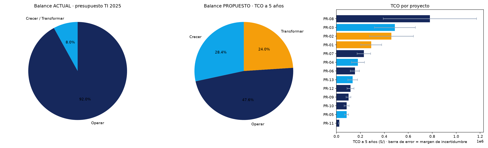
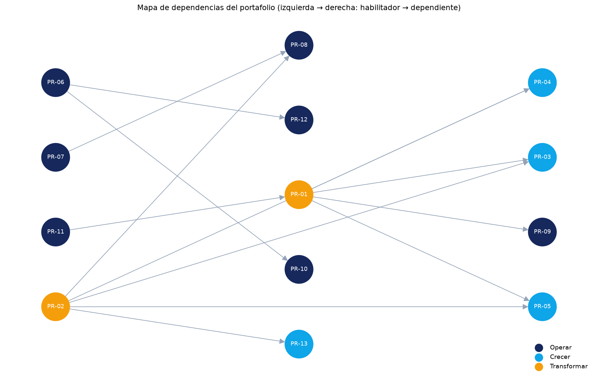

# 7.1 Portafolio de proyectos

**PETI · Distribuidora Andina del Sur S.A.C.** · versión v0.13 · Información confidencial

> Cifras en soles (S/). Son estimaciones de orden de magnitud: cada una se presenta con su rango de incertidumbre, no como valor cerrado. Se calculan con los programas de esta carpeta, y la salida de cada programa está en [`evidencias/S13/salidas/`](../evidencias/S13/salidas/).

## 7.1.1 Fuentes admisibles y control de admisión

Un candidato entra al portafolio solo si nace de una de las cinco fuentes del plan y responde a un objetivo de la Sección 6.2:

| Fuente | Sección de origen | Candidatos |
|---|---|---|
| Estrategias FODA | 3.5 | C-06, C-10, C-12 |
| Obligaciones normativas | 4.1.5 | C-02, C-11 |
| Brechas de capacidad | 4.3.5 | C-08, C-09, C-13 |
| Brechas de arquitectura | 5.4.2 | C-01, C-03, C-07 |
| Brechas de servicio digital y de línea base | 6.1.5 y 6.1.7 | C-04, C-05, C-14, C-15 |

**Resultado del control** ([`PF01_consolidacion.py`](PF01_consolidacion.py), [salida](../evidencias/S13/salidas/PF01_salida.txt)). Se recibieron 17 candidatos, se retiraron 2 y se fusionaron 2. Quedan **13 proyectos admitidos**.

| Candidato | Decisión | Razón |
|---|---|---|
| C-16 Renovación de laptops de gerencia | **Retirado** | Viene de un correo de un área usuaria, no de una de las cinco fuentes, y no responde a ningún objetivo. Es una reposición operativa que va al presupuesto corriente. |
| C-17 Asistente conversacional con IA generativa | **Retirado** | Viene de una propuesta comercial no solicitada y no responde a ningún objetivo. Si el diagnóstico lo justifica, puede volver en la próxima revisión del plan. |
| C-05 Consulta de estado de pedido | **Fusionado en C-04 → PR-03** | Es un entregable del canal B2B: tiene el mismo usuario, la misma plataforma y la misma integración. |
| C-02 Registro de actividades de tratamiento | **Fusionado en C-11 → PR-09** | Es el primer entregable del programa de cumplimiento de la Ley 29733. |

## 7.1.2 Portafolio de proyectos

Fuente de la tabla: [`PF01_portafolio_candidatos.csv`](PF01_portafolio_candidatos.csv)

| Código | Proyecto | Fuente · sección de origen | Objetivo | Categoría |
|---|---|---|---|---|
| PR-01 | Gobierno del dato maestro | Brecha de arquitectura · 5.4.2 PT-01 | OD-02, OD-03 | Transformar |
| PR-02 | Capa de integración de servicios | Brecha de arquitectura · 5.4.2 PT-02 | OD-01, OD-03 | Transformar |
| PR-03 | Canal digital B2B (incluye consulta de estado de pedido) | Servicio digital · 6.1.7 S-01, S-02 | OD-01 | Crecer |
| PR-04 | Planificación de rutas y trazabilidad de despacho | FODA · 3.5 E-02 | OD-03 | Crecer |
| PR-05 | Tablero de gestión comercial | Brecha de arquitectura · 5.4.2 PT-05 | OD-02 | Crecer |
| PR-06 | Mesa de servicio de TI | Brecha de capacidad · 4.3.5 DSS02 | OD-04 | Operar |
| PR-07 | Continuidad de infraestructura y respaldo inmutable | Brecha de capacidad · 4.3.5 DSS04 | OD-04 | Operar |
| PR-08 | Renovación de la plataforma del ERP | FODA · 3.5 E-04 | OD-04 | Operar |
| PR-09 | Programa de cumplimiento de datos personales (incluye registro de tratamiento) | Obligación normativa · 4.1.5 | OD-05 | Operar |
| PR-10 | Gestión del conocimiento y de la configuración | FODA · 3.5 E-07 | OD-06 | Operar |
| PR-11 | Comité de gobierno de TI | Brecha de capacidad · 4.3.5 EDM01 | OD-02, OD-04 | Operar |
| PR-12 | Instrumentación de monitoreo y disponibilidad | Brecha de línea base · 6.1.5 | OD-04 | Operar |
| PR-13 | Autoservicio de trabajadores (boletas y vacaciones) | Servicio digital · 6.1.7 S-06, S-07 | OD-01 | Crecer |

## 7.1.3 Fichas de proyecto

Cada proyecto tiene su ficha estandarizada de 20 campos en [`PF03_fichas/`](PF03_fichas/), desde [PR-01](PF03_fichas/PR-01.md) hasta [PR-13](PF03_fichas/PR-13.md). Las genera [`PF03_fichas.py`](PF03_fichas.py) a partir de PF01, PF02 y el modelo de dependencias, de modo que la ficha y el TCO no pueden contradecirse. Las fichas hacen comparables los proyectos para la priorización de la Semana 14.

## 7.1.4 Costo total de propiedad

Fuentes: [`PF02_tco.py`](PF02_tco.py), [`PF02_tco.csv`](PF02_tco.csv) y su [salida](../evidencias/S13/salidas/PF02_salida.txt). El TCO suma el costo único (inversión, capacitación, migración e integración) y cinco años de costo operativo (licencias, infraestructura, soporte y personal).

| Código | Categoría | Inversión inicial | Costo operativo anual | TCO 5 años | Rango | Factor TCO/inversión | % operativo |
|---|---|---:|---:|---:|---|---:|---:|
| PR-01 | Transformar | 55 000 | 41 850 | 290 250 | 203 200 – 377 300 | 5.28× | 72.1 % |
| PR-02 | Transformar | 78 000 | 71 640 | 459 200 | 275 500 – 642 900 | 5.89× | 78.0 % |
| PR-03 | Crecer | 110 000 | 67 500 | 488 500 | 317 500 – 659 500 | 4.44× | 69.1 % |
| PR-04 | Crecer | 34 000 | 25 500 | 179 500 | 125 600 – 233 400 | 5.28× | 71.0 % |
| PR-05 | Crecer | 15 000 | 12 900 | 84 500 | 67 600 – 101 400 | 5.63× | 76.3 % |
| PR-06 | Operar | 28 000 | 22 200 | 154 000 | 115 500 – 192 500 | 5.50× | 72.1 % |
| PR-07 | Operar | 62 000 | 32 640 | 229 200 | 171 900 – 286 500 | 3.70× | 71.2 % |
| PR-08 | Operar | 145 000 | 110 100 | 780 500 | 390 200 – 1 170 800 | 5.38× | 70.5 % |
| PR-09 | Operar | 24 000 | 14 400 | 101 000 | 80 800 – 121 200 | 4.21× | 71.3 % |
| PR-10 | Operar | 19 000 | 11 880 | 85 400 | 64 000 – 106 800 | 4.49× | 69.6 % |
| PR-11 | Operar | 6 000 | 3 000 | 23 000 | 19 600 – 26 400 | 3.83× | 65.2 % |
| PR-12 | Operar | 22 000 | 17 640 | 117 200 | 87 900 – 146 500 | 5.33× | 75.3 % |
| PR-13 | Crecer | 26 000 | 18 900 | 135 500 | 94 800 – 176 200 | 5.21× | 69.7 % |
| **Total** | | **624 000** | **450 150** | **3 127 750** | **2 014 100 – 4 241 400** | **5.01×** | |

**Interpretación del factor TCO/inversión.** El portafolio cuesta **5.0 veces** su inversión inicial en cinco años. Si a la gerencia se le presentan solo los S/ 624 000 de inversión, el compromiso queda subestimado en **S/ 2.5 millones**. Ese monto se pagaría como gasto recurrente que nadie aprobó de forma explícita.

En régimen, el costo operativo anual del portafolio (S/ 450 150) equivale al **61 % del presupuesto de TI actual**. El plan tiene que prever ese crecimiento del gasto recurrente.

**Proyectos de mayor carga operativa recurrente.** PR-02 (78 %), PR-05 (76 %), PR-12 (75 %) y PR-01 (72 %). Su costo está sobre todo en suscripciones y personal, no en la compra, por lo que exigen el mayor escrutinio antes de aprobarse.

**Línea base del costo operativo.** En 2025 la organización pagó **S/ 2.24 millones** por «servicio informático» a 78 proveedores, en 1 429 comprobantes (`pagos.csv`). Eso es **3.0 veces** su presupuesto de TI aprobado (S/ 742 000). Una parte del gasto de TI ocurre fuera del presupuesto del área, así que el costo operativo de este TCO es un piso, no un techo.

## 7.1.5 Casos de negocio de los proyectos de mayor inversión

Los tres proyectos de mayor TCO son **PR-08, PR-03 y PR-02**. Fuentes: [`PF04_alternativas.py`](PF04_alternativas.py), [`PF04_alternativas.csv`](PF04_alternativas.csv) y su [salida](../evidencias/S13/salidas/PF04_salida.txt). La alternativa B de cada caso es la que describen la ficha y el TCO de 7.1.4.

**Línea base: cómo decide hoy la organización.** Los tres expedientes de inversión de 2025 tienen estos datos:

| Expediente | Aprobado (S/) | Ejecutado (S/) | Desviación |
|---|---:|---:|---:|
| Sistema de respaldo | 58 183 | 75 884 | +30.4 % |
| Actualización de licencias | 203 210 | 244 795 | +20.5 % |
| Renovación de servidores | 209 033 | 243 536 | +16.5 % |
| **Total** | **470 426** | **564 215** | **+19.9 %** |

Ninguno tuvo caso de negocio con alternativas, acta de aceptación ni medición del beneficio. Las «alternativas» fueron tres cotizaciones del mismo producto. Los casos que siguen reemplazan esa práctica.

### Caso 1 · PR-08 Renovación de la plataforma del ERP

| Alternativa | Costo 5 años | Beneficio 5 años | Neto 5 años | Retorno |
|---|---:|---:|---:|---:|
| A. No hacer nada | 0 | −900 000 | **−900 000** | — |
| B. Migrar a la versión soportada del mismo proveedor | 780 500 | 1 100 000 | **319 500** | 40.9 % |
| C. Reemplazar por otra solución ERP | 980 000 | 1 250 000 | 270 000 | 27.6 % |

**Costo de la inacción: S/ 900 000 en 5 años.** Se estiman 2 días al año de interrupción, con S/ 188 000 de venta diaria y un 40 % de venta no recuperada. A eso se suman S/ 30 000 al año de soporte extendido. **Recomendación: B.** Da el mayor beneficio neto con el menor riesgo de migración. C queda como opción para el siguiente ciclo del plan, cuando PR-02 haya desacoplado las integraciones.

| Dimensión | A quién afecta | Efecto esperado, con su cifra o indicador | Norma o derecho aplicable |
|---|---|---|---|
| Sociedad | 1 800 clientes mayoristas (bodegas y minimarkets) | Sin días de desabastecimiento por caída del ERP; hoy el riesgo es de 2 días al año | — |
| Economía | Organización y proveedores | Evita S/ 180 000 al año de pérdida esperada y acorta en 3 días el cierre contable mensual | — |
| Salud y seguridad | Personal de almacén | No aplica de forma directa: el ERP no controla procesos con riesgo físico. Se declara para no dejar la fila vacía | — |
| Marco legal | Organización ante SUNAT | Mantiene la emisión electrónica de comprobantes con un sistema soportado y parchado | Normas de comprobantes electrónicos de SUNAT |
| Medio ambiente | — | Los servidores locales se retiran si se migra a la nube del proveedor; el efecto en consumo eléctrico se mide en la Semana 16 | — |

### Caso 2 · PR-03 Canal digital B2B

| Alternativa | Costo 5 años | Beneficio 5 años | Neto 5 años | Retorno |
|---|---:|---:|---:|---:|
| A. No hacer nada | 0 | −475 000 | **−475 000** | — |
| B. Rediseño móvil del portal existente + consulta de pedido | 488 500 | 725 000 | **236 500** | 48.4 % |
| C. Nueva plataforma de comercio B2B | 710 000 | 875 000 | 165 000 | 23.2 % |

**Costo de la inacción: S/ 475 000 en 5 años.** Hoy se toman 74 400 pedidos al año por teléfono. El tiempo de la fuerza de ventas cuesta S/ 70 000 al año y las notas de crédito por errores de transcripción, S/ 25 000 al año. **Recomendación: B**, condicionada a que PR-01 y PR-02 terminen antes.

| Dimensión | A quién afecta | Efecto esperado, con su cifra o indicador | Norma o derecho aplicable |
|---|---|---|---|
| Sociedad | Clientes mayoristas | Hacen y consultan su pedido sin llamar: −50 % de llamadas a la fuerza de ventas | Ley 29571, Código de Protección al Consumidor (información del pedido) |
| Economía | Organización | −S/ 95 000 al año de costo de toma de pedidos y de errores | — |
| Salud y seguridad | Vendedores en ruta | Menos llamadas mientras conducen entre clientes | — |
| Marco legal | Clientes | El portal trata datos personales y requiere el consentimiento de PR-09 | Ley 29733 de Protección de Datos Personales |
| Medio ambiente | — | Menos pedidos impresos en papel; el indicador (hojas por mes) se mide desde la línea base | — |

### Caso 3 · PR-02 Capa de integración de servicios

| Alternativa | Costo 5 años | Beneficio 5 años | Neto 5 años | Retorno |
|---|---:|---:|---:|---:|
| A. No hacer nada | 0 | −350 000 | **−350 000** | — |
| B. Plataforma de integración (iPaaS) en la nube | 459 200 | 500 000 | **40 800** | 8.9 % |
| C. Desarrollo de APIs a medida sin plataforma | 415 000 | 425 000 | 10 000 | 2.4 % |

**Costo de la inacción: S/ 350 000 en 5 años.** Corresponde a la conciliación manual diaria (S/ 45 000 al año) y a los reprocesos por pedidos duplicados (S/ 25 000 al año). **Recomendación: B.** Su retorno propio es bajo, pero es un proyecto **habilitador**: sin él no pueden ejecutarse PR-03, PR-04, PR-05, PR-08 ni PR-13. El beneficio de esos proyectos no se cuenta aquí para no contarlo dos veces.

| Dimensión | A quién afecta | Efecto esperado, con su cifra o indicador | Norma o derecho aplicable |
|---|---|---|---|
| Sociedad | Trabajadores de Administración | 2 personas a medio tiempo dejan la conciliación manual y pasan a tareas de análisis | — |
| Economía | Organización | −S/ 70 000 al año de conciliación y reprocesos | — |
| Salud y seguridad | — | No aplica: es un componente técnico sin interacción física | — |
| Marco legal | Clientes y trabajadores | Los datos personales pasan por canales cifrados con trazabilidad de accesos | Ley 29733 y su reglamento (medidas de seguridad) |
| Medio ambiente | — | No aplica de forma directa; la plataforma en la nube comparte infraestructura y no añade servidores propios | — |

## 7.1.6 Balance del portafolio

Fuentes: [`PF05_balance.py`](PF05_balance.py), su [salida](../evidencias/S13/salidas/PF05_salida.txt) y el gráfico [`PF_balance.png`](../graficos/PF_balance.png).

| Categoría | Proyectos | Inversión (S/) | TCO 5 años (S/) | % del TCO | Referencia | Estado |
|---|---:|---:|---:|---:|---|---|
| Operar | 7 | 306 000 | 1 490 300 | 47.6 % | 50–70 % | Por debajo |
| Crecer | 4 | 185 000 | 888 000 | 28.4 % | 20–30 % | Dentro |
| Transformar | 2 | 133 000 | 749 450 | 24.0 % | 10–20 % | Por encima |

**Contraste con el balance actual (Sección 3.1).** El presupuesto de TI de 2025 dedica el **92.0 % a operar** (93.8 % de lo ejecutado). Solo el 8.0 % va a la partida «Proyectos nuevos», que además se ejecutó un 33.9 % por debajo de lo planificado. El portafolio propone que **52 % del TCO** vaya a crecer y transformar.

El cambio es deliberado. Operar queda ligeramente por debajo de la referencia y Transformar por encima porque PR-01 y PR-02 son habilitadores que el resto del portafolio necesita. Esta sobreinversión es temporal: cuando terminen, el balance vuelve al rango de referencia. El PETI debe asegurar que ese cambio tenga financiamiento aprobado y no dependa de la partida de proyectos nuevos, que hoy se subejecuta.

## 7.1.7 Dependencias entre proyectos

Fuentes: [`PF06_dependencias.py`](PF06_dependencias.py), su [salida](../evidencias/S13/salidas/PF06_salida.txt) y el gráfico [`PF_dependencias.png`](../graficos/PF_dependencias.png).

**Orden topológico.** PR-02 → PR-06 → PR-07 → PR-08 → PR-10 → PR-11 → PR-01 → PR-03 → PR-04 → PR-05 → PR-09 → PR-12 → PR-13

| Oleada | Proyectos | Condición |
|---|---|---|
| 1 | PR-02, PR-06, PR-07, PR-11 | No dependen de nadie y pueden iniciar de inmediato |
| 2 | PR-01, PR-08, PR-10, PR-12, PR-13 | Necesitan algún proyecto de la oleada 1 |
| 3 | PR-03, PR-04, PR-05, PR-09 | Necesitan PR-01 y, en la mayoría de casos, PR-02 |

**Proyectos habilitadores.**
- **PR-02** habilita 5 proyectos.
- **PR-01** habilita 4 proyectos.
- **PR-11** habilita 5 proyectos en cadena, a través de PR-01.

Ninguno de los tres tiene un retorno propio relevante: PR-02 rinde 8.9 % y PR-11 no tiene retorno. Aun así tienen prioridad estructural, porque priorizarlos solo por su beneficio directo bloquearía más de la mitad del portafolio. **Esta secuencia condiciona la hoja de ruta (Sección 7.3).**

## 7.1.8 Cobertura de objetivos

Fuente: verificación automática en [`PF01_consolidacion.py`](PF01_consolidacion.py) ([salida](../evidencias/S13/salidas/PF01_salida.txt)).

| Objetivo (Sección 6.2) | Proyectos |
|---|---|
| OD-01 Digitalizar los servicios a clientes y trabajadores | PR-02, PR-03, PR-13 |
| OD-02 Decidir con datos confiables y oportunos | PR-01, PR-05, PR-11 |
| OD-03 Integrar la cadena pedido-almacén-despacho | PR-01, PR-02, PR-04 |
| OD-04 Asegurar la continuidad y disponibilidad de los servicios de TI | PR-06, PR-07, PR-08, PR-11, PR-12 |
| OD-05 Cumplir la Ley 29733 de protección de datos personales | PR-09 |
| OD-06 Profesionalizar la gestión de TI y su conocimiento | PR-10 |

Los seis objetivos tienen al menos un proyecto, y ningún proyecto cita un objetivo inexistente. OD-05 y OD-06 dependen de un único proyecto cada uno, así que un retraso en PR-09 o PR-10 deja ese objetivo sin avance.
